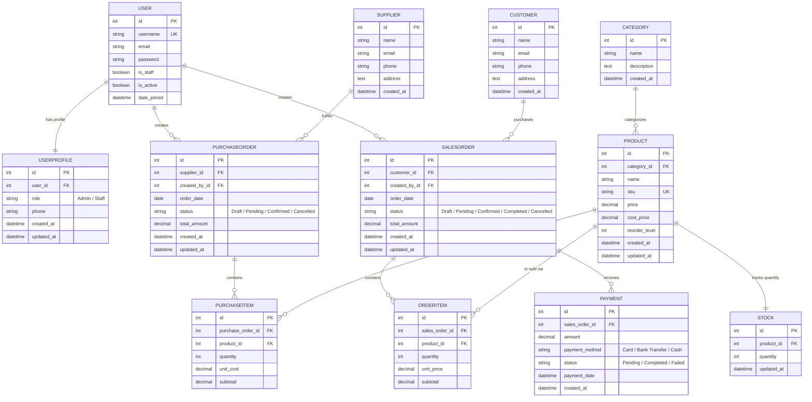

# OpsFlow — Digital Operations Management Platform

[](https://www.python.org/)
[](https://www.djangoproject.com/)
[](https://reactjs.org/)
[](https://vitejs.dev/)
[]()

OpsFlow is an enterprise-grade digital operations platform engineered for small and medium-sized businesses (SMEs) to unify inventory management, supplier purchasing, customer sales orders, payment reconciliation, and real-time business intelligence into a single, cohesive system.

---

## Architecture Overview

OpsFlow is architected using a decoupled Client-Server model following **Object-Oriented Programming (OOP)** and **Clean Architecture (Service Layer Pattern)** principles.

```
┌────────────────────────────────────────────────────────┐
│                   React 18 + Vite SPA                  │
│       (Context API, Axios Interceptors, Recharts)      │
└───────────────────────────┬────────────────────────────┘
                            │  HTTP / JSON + Token Auth
┌───────────────────────────▼────────────────────────────┐
│              Django REST Framework Layer               │
│        (ViewSets, Serializers, Permission Guards)      │
└───────────────────────────┬────────────────────────────┘
                            │  Delegates to
┌───────────────────────────▼────────────────────────────┐
│                  OOP Service Layer                     │
│    (OrderProcessingService, InventoryService, etc.)    │
└───────────────────────────┬────────────────────────────┘
                            │  Encapsulates Domain Logic
┌───────────────────────────▼────────────────────────────┐
│               Domain Models & DB Engine                │
│    (3NF Normalized, transaction.atomic(), Signals)     │
└────────────────────────────────────────────────────────┘
```

### Key OOP & Design Patterns
- **Service Layer Pattern:** ViewSets remain thin HTTP controllers. Complex multi-table business operations (atomic stock increments/decrements, fulfillment audits) are isolated inside `services.py`.
- **Domain Encapsulation:** Models contain rich business logic (e.g., `SalesOrder.can_fulfill()`, `Stock.deduct()`, `Stock.increase()`).
- **3NF Relational Normalization:** Dynamic inventory counts are segregated in a dedicated `Stock` model to prevent row-locking contention on the primary `Product` metadata table.
- **Atomic Concurrency Safety:** Stock mutations are executed strictly within `transaction.atomic()` blocks with pre-validation to prevent partial updates and race conditions.

---

## 11-Entity Detailed ERD



---

## API Specification

All protected endpoints require the HTTP header:  
`Authorization: Token <token_key>`

### Authentication & Users
| Method | Endpoint | Description | Auth Required |
|---|---|---|---|
| `POST` | `/api/auth/login/` | Authenticate credentials and receive token | No |
| `POST` | `/api/auth/logout/` | Invalidate token and destroy session | Yes |
| `GET` | `/api/auth/me/` | Retrieve current authenticated user profile | Yes |

### Inventory & Catalog
| Method | Endpoint | Description | Auth Required |
|---|---|---|---|
| `GET`, `POST` | `/api/categories/` | List and create categories | Yes |
| `GET`, `PUT`, `DELETE` | `/api/categories/{id}/` | Retrieve, update, delete category | Yes |
| `GET`, `POST` | `/api/products/` | List (supports `?search=` & `?category=`) & create products | Yes |
| `GET`, `PUT`, `DELETE` | `/api/products/{id}/` | Retrieve, update, delete product | Yes |
| `GET` | `/api/stock/` | View current stock counts | Yes |
| `GET` | `/api/stock/low/` | Filter products at or below reorder threshold | Yes |
| `GET`, `POST` | `/api/suppliers/` | List and create suppliers | Yes |
| `GET`, `POST` | `/api/customers/` | List and create customers | Yes |

### Orders & Procurement
| Method | Endpoint | Description | Auth Required |
|---|---|---|---|
| `GET`, `POST` | `/api/purchases/` | List and create purchase orders with nested line items | Yes |
| `GET` | `/api/purchases/{id}/` | Retrieve purchase order and item details | Yes |
| `POST` | `/api/purchases/{id}/confirm/` | Atomically receive goods and increment stock | Yes |
| `GET`, `POST` | `/api/orders/` | List and create sales orders with nested line items | Yes |
| `GET` | `/api/orders/{id}/` | Retrieve sales order and item details | Yes |
| `POST` | `/api/orders/{id}/confirm/` | Validate inventory & atomically deduct stock | Yes |

### Payments & Dashboard
| Method | Endpoint | Description | Auth Required |
|---|---|---|---|
| `GET`, `POST` | `/api/payments/` | List and record payments against sales orders | Yes |
| `GET` | `/api/dashboard/` | Real-time KPIs, revenue trend chart, low-stock warnings | Yes |

---

## Installation & Setup

### 1. Prerequisites
- Python 3.10+
- Node.js 18+ and npm

### 2. Backend Setup
```bash
cd backend
python -m venv venv
# Windows:
venv\Scripts\activate
# Unix/Mac:
source venv/bin/activate

pip install -r requirements.txt
python manage.py migrate
python manage.py runserver
```
The Django REST API runs on `http://localhost:8000/`.

### 3. Frontend Setup
```bash
cd frontend
npm install
npm run dev
```
The Vite development server runs on `http://localhost:5173/`.

### 4. Running the Test Suite
The project includes a 20-test automated test suite covering authentication, stock signals, atomic stock increments/decrements, and out-of-stock validation:
```bash
cd backend
python manage.py test
```
All 20 test cases will execute and verify database atomicity and business invariants.
