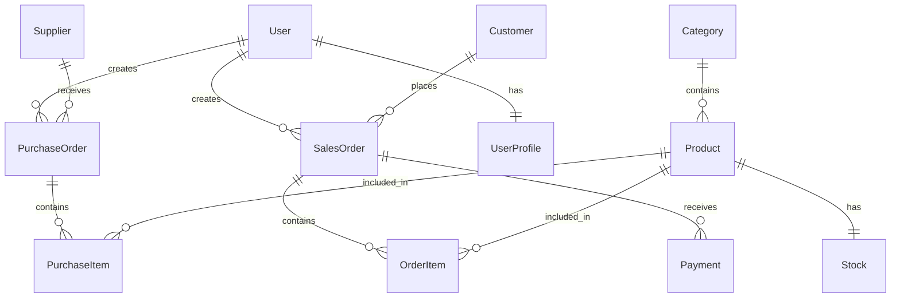

# Business Inventory & Order Management System

A comprehensive web application for managing business inventory, purchase orders, sales orders, and payments.

## Features
- **Authentication:** Token-based authentication with Admin and Staff roles.
- **Inventory Management:** Manage categories, products, and real-time stock levels.
- **Order Management:** Create and track purchase orders (suppliers) and sales orders (customers).
- **Payment Processing:** Record and track payments for sales orders.
- **Dashboard:** Overview of key business metrics.

## Tech Stack
- **Backend:** Django, Django REST Framework, SQLite
- **Frontend:** React, Vite, Axios, TailwindCSS (assumed)
- **Authentication:** JWT (JSON Web Tokens) or Django REST Framework TokenAuth

## System Architecture
The system follows a standard Client-Server architecture. The React frontend communicates with the Django backend via RESTful APIs over HTTP/JSON. The backend uses Django Models to interact with the SQLite database.

## Database Design
The database consists of core entities for users, inventory, and orders:
- **Users:** User, UserProfile
- **Inventory:** Category, Product, Stock
- **CRM:** Supplier, Customer
- **Purchasing:** PurchaseOrder, PurchaseItem
- **Sales:** SalesOrder, OrderItem, Payment

## ERD


## API Documentation
| Method | Endpoint | Description | Auth Required |
|--------|----------|-------------|---------------|
| POST | /api/auth/login/ | User login | No |
| GET/POST | /api/inventory/categories/ | Manage categories | Yes |
| GET/POST | /api/inventory/products/ | Manage products | Yes |
| GET | /api/inventory/stock/ | View stock levels | Yes |
| GET/POST | /api/orders/purchase/ | Manage purchase orders | Yes |
| GET/POST | /api/orders/sales/ | Manage sales orders | Yes |
| GET/POST | /api/orders/payments/ | Manage payments | Yes |

## Installation

### Backend Setup
1. Navigate to `backend/`
2. Create virtual environment: `python -m venv venv`
3. Activate virtual environment.
4. Install dependencies: `pip install -r requirements.txt`
5. Run migrations: `python manage.py migrate`
6. Create superuser: `python manage.py createsuperuser`

### Frontend Setup
1. Navigate to `frontend/`
2. Install dependencies: `npm install`

## Environment Variables
Create a `.env` file in the backend and frontend directories as needed (e.g., API URLs, Secret Keys).

## Running the Application
- **Backend:** `python manage.py runserver`
- **Frontend:** `npm run dev`

## Testing
Run backend tests with `python manage.py test`.

## Project Structure
```
├── backend/
│   ├── accounts/
│   ├── config/
│   ├── inventory/
│   ├── orders/
│   └── manage.py
├── frontend/
│   ├── src/
│   ├── public/
│   ├── package.json
│   └── vite.config.js
├── docs/
│   └── documentation.md
└── README.md
```

## Screenshots
*Screenshots of the running application are included in the /screenshots directory.*

## Future Improvements
- Automated email notifications.
- Advanced reporting and analytics.
- Barcode scanning integration.
- Multi-warehouse support.

## Contributors
- Zainab Khan
