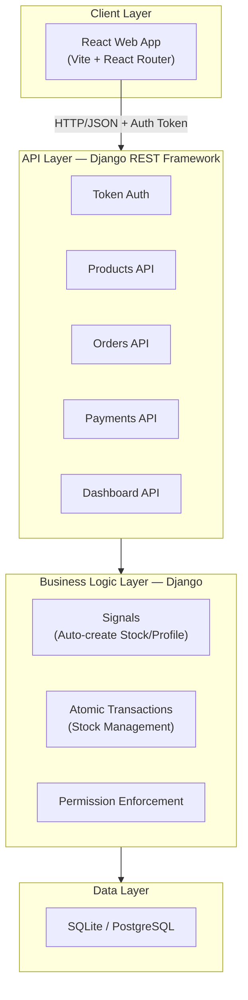
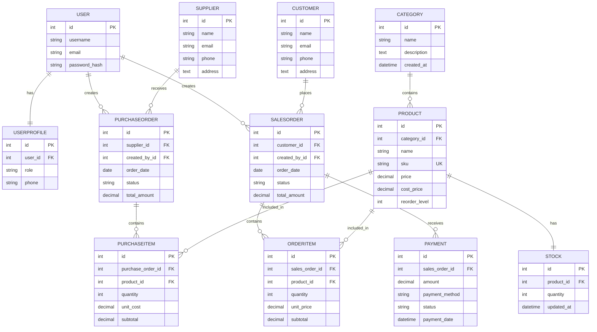
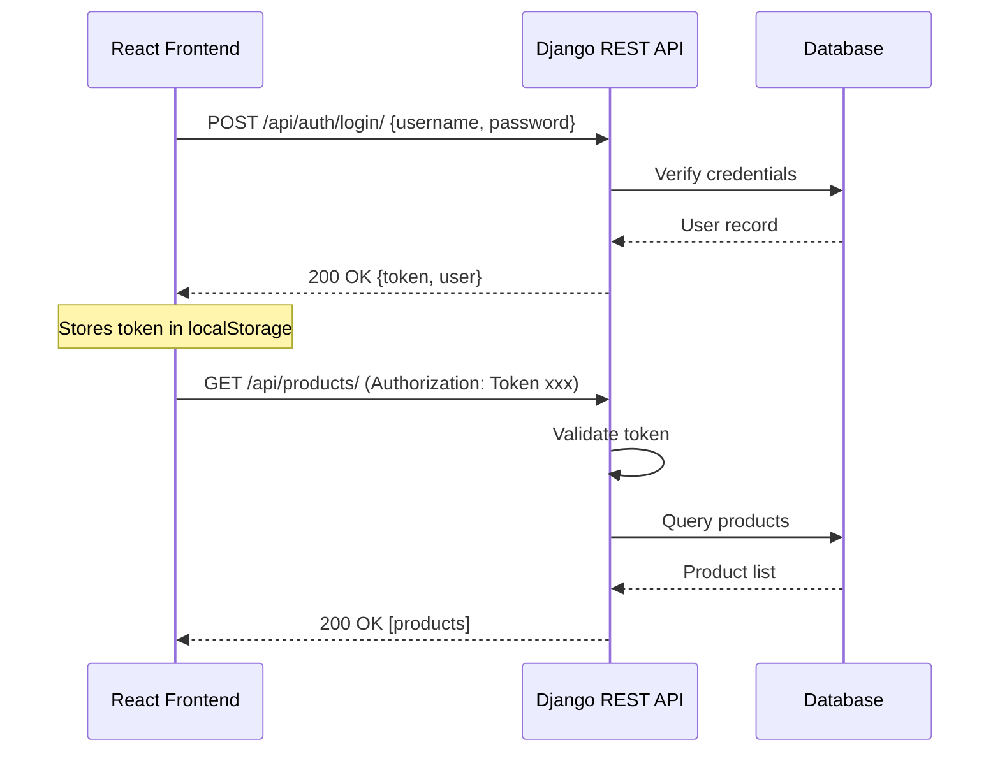
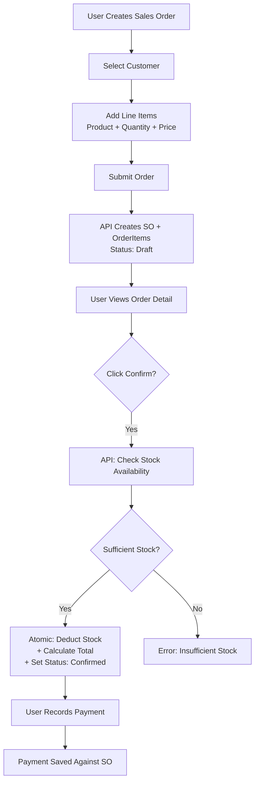
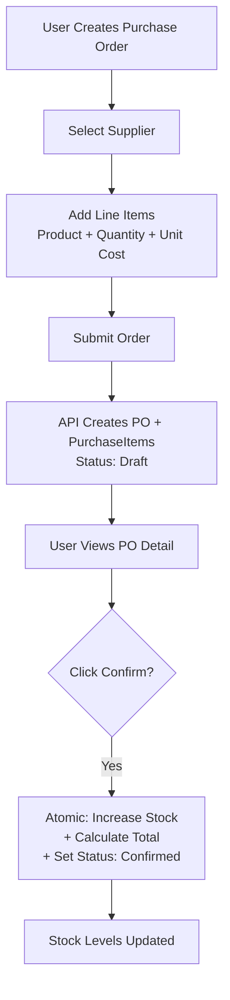

# OpsFlow — R&D Process Document

## Digital Operations Management System for Small and Medium-Sized Businesses

---

**Prepared by:** Zainab Khan
**Date:** September 2026
**Version:** 1.0
**GitHub Repository:** https://github.com/zkestroyer/casestudy

---

## Table of Contents

**Phase 1 — Problem & Research**
1. Find and Understand the Problem
2. Find the Relevant Researches
3. Find the Relevant Existing Solutions
4. Conclude Your Research in Table Form
5. Suggest Solution and Discuss with Coordinator

**Phase 2 — Proposal & Planning**
6. Innovation Proposal
7. Creative Overview
8. Research and Feasibility Study
9. Technology Road Map

**Phase 3 — Proof of Concept**
10. Proof of Concept
11. Final Combined Report

**Phase 4 — Prototyping & Experimentation**
12. Prototyping and Experimentation
13. Prototyping and Experimentation Log

**Phase 5 — Documentation & Handover**
14. Complete Documentation & Project Course Report
15. Finalize the Project

---

---

# PHASE 1 — PROBLEM & RESEARCH

---

## 1. Find and Understand the Problem

### 1.1 Problem Statement

Small and medium-sized businesses (SMEs) manage purchasing, inventory, sales, and payment records through a fragmented collection of tools: spreadsheets, paper records, messaging applications, or disconnected software systems. This fragmented approach creates a cascade of operational problems:

- **Stock discrepancies** between recorded and physical inventory
- **Duplicate data entry** across multiple systems
- **Fulfilment delays** from poor visibility into available stock
- **Lack of operational visibility** for management decision-making
- **Stockouts** from failure to reorder in time
- **Overstocking** from poor demand visibility
- **Difficulty tracking transactions** and reconciling payments

### 1.2 Affected Users

Business owners, operations managers, warehouse staff, purchasing officers, sales staff, and finance personnel in SMEs across retail, wholesale, distribution, and light manufacturing with 5–50 employees and $500K–$10M annual revenue.

### 1.3 Current Process (As-Is)

The typical SME manages operations through a combination of:
1. Excel or Google Sheets for stock tracking
2. Paper purchase orders and receiving documents
3. Messaging apps (WhatsApp, email) for supplier and customer communication
4. Separate accounting software (QuickBooks/Xero) for payments and invoicing
5. Manual stock counts for reconciliation

**Example Current Workflow (Purchasing):**
Staff notices low stock → Emails/WhatsApps supplier for quote → Creates purchase order in spreadsheet → Emails PO to supplier → Receives goods, checks against paper delivery note → Manually updates spreadsheet → Enters payment in accounting software → No automatic stock update or reorder alert.

### 1.4 Consequences / Business Impact

| Pain Point | Description | Business Impact |
|------------|-------------|-----------------|
| Data Duplication | Same info entered into spreadsheets, POS, and accounting software | Wasted staff time, increased error risk |
| Stock Discrepancies | Recorded stock differs from physical stock | Lost sales (stockouts), excess capital tied up |
| Delayed Updates | Inventory changes not reflected in real-time | Order fulfilment delays, customer dissatisfaction |
| Manual Reconciliation | Hours spent matching records across systems | High labour costs, delayed decision-making |
| Poor Visibility | No real-time dashboard for operations | Reactive rather than proactive management |
| No Audit Trail | Changes not tracked or attributed | Accountability issues |
| Payment Tracking | No integrated view of outstanding payments | Cash flow uncertainty |

### 1.5 Frequency / Severity

| Metric | Estimate |
|--------|----------|
| Time spent on manual reconciliation | 5–10 hours/week per business |
| Stock discrepancy rate | 5–15% of SKUs have record-physical mismatch |
| Stockout frequency | 1–3 stockouts per month for typical SME |
| Lost sales from stockouts | 5–15% of potential revenue |
| Overstock carrying cost | 20–30% of inventory value annually |
| Order fulfilment errors | 3–8% of orders |

---

## 2. Find the Relevant Researches

### 2.1 Academic & Industry Research

| # | Research Title | Source | Year | Key Finding |
|---|---------------|--------|------|-------------|
| 1 | Micro-enterprise Inventory Methods Study | Sharma et al. | 2025 | 62.5% of micro-enterprises depend on manual inventory methods; medium enterprises significantly adopted EOQ (69.2%), JIT (55.0%), and cloud-based tools (61.8%) |
| 2 | UAE SMEs: Simple Tools Win | SME10x | 2026 | 64% of SMEs rely on spreadsheets for core operations; >60% manage inventory outside main systems |
| 3 | SMB Application Adoption Plans | Bredin | 2025 | Inventory management has the highest share of new adopters among small businesses |
| 4 | Why SMBs Aren't Using AI for Inventory | Cin7 | 2025 | 47% of SMBs not using automation want to; 41% not using AI are eager to upgrade |
| 5 | Benefits of Inventory Management Systems | Capterra | 2026 | 49% switch tools because inefficiency slows daily work; 33% switch when basic tracking can't support growth; 56% say inventory tracking is critical |
| 6 | Inventory Management Benchmark Report | Netstock | 2025 | AI adoption among SMBs doubled in past year; 48% now using AI; 59% using automation |
| 7 | Small Businesses Inventory Management Software Market | Research and Markets | 2026 | Global market valued at $2.74B in 2025, projected $5.41B by 2032, CAGR 10.18% |
| 8 | Barcode Inventory Management Software Market | 360iResearch | 2026 | Market at $1.28B in 2025, 11.50% CAGR; cloud-native, mobile-first, integration-led platforms trending |
| 9 | Inventory Management Software Market Trends | Mordor Intelligence | 2025 | SMEs are the fastest-growing segment at 13.12% CAGR |
| 10 | SME Inventory Management Penetration | Suda Tianyao | 2026 | Overall penetration at 68.3%; >70% in e-commerce/retail; 80% of MSMEs projected digitally equipped by 2027 |

### 2.2 Market Statistics Summary

| Statistic | Value | Source |
|-----------|-------|--------|
| Global SME Inventory Software Market (2025) | $2.74 billion | Research and Markets |
| Projected Market (2032) | $5.41 billion | Research and Markets |
| CAGR | 10.18% | Research and Markets |
| SME cloud adoption penetration | 68.3% | Suda Tianyao |
| SMEs on spreadsheets | 64% | SME10x |
| SMBs wanting automation | 47% | Cin7 |
| Tool switching due to inefficiency | 49% | Capterra |

---

## 3. Find the Relevant Existing Solutions

### 3.1 Direct Competitor Solutions

| # | Solution | Target Customer | Key Features | Pricing | Limitations |
|---|----------|----------------|--------------|---------|-------------|
| 1 | **Zoho Inventory** | SMB e-commerce sellers | Multi-channel sales, real-time stock, shipping integrations, barcode scanning | Free–$249/month | Limited reporting, FIFO-only costing, UI not optimised for high volume |
| 2 | **Odoo Inventory** | SMEs needing ERP | Warehouse management, manufacturing, multi-location, FIFO/FEFO costing | $31.10/user/month | Complex setup, higher cost with multiple apps, requires technical resources |
| 3 | **Square** | Retailers, restaurants | POS integration, real-time stock, multi-location, inventory reporting | Free–$149/location/month | Limited purchasing functionality, inventory requires higher-tier plans |
| 4 | **inFlow Inventory** | B2B and wholesale | B2B portal, inventory tracking, manufacturing | $89–$1,055/month | Expensive for small teams, complex interface |
| 5 | **Cin7** | Multi-location businesses | End-to-end inventory, automatic notifications, integrations | From $295/month | Very expensive, overkill for small SMEs |
| 6 | **Sortly** | Small businesses | Inventory tracking, asset tracking, barcode/QR scanning | From $24/month | Very basic, no purchasing or sales order workflows |

### 3.2 Indirect Alternatives

| Alternative | Usage | Limitations |
|-------------|-------|-------------|
| **Spreadsheets (Excel/Google Sheets)** | Primary tracking tool for 64% of SMEs | No real-time updates, error-prone, no automation, no audit trail |
| **Paper Records** | Purchase orders, receiving documents | No searchability, loss risk, manual reconciliation |
| **Accounting Software (QuickBooks/Xero)** | Invoicing, payments | Limited inventory, no purchasing workflows |
| **Manual Processes** | Stock counts, order management | Time-consuming, inaccurate, unscalable |

---

## 4. Conclude Your Research in Table Form

### Research Conclusion Table

| # | Name | Link / Source | Description | Technology / Technique | Achievement | Challenges | Localities | Alternative Approaches |
|---|------|--------------|-------------|----------------------|-------------|------------|------------|----------------------|
| 1 | **Zoho Inventory** | zoho.com/inventory | Cloud-based multi-channel inventory management for SMB e-commerce sellers | Cloud SaaS, REST APIs, multi-warehouse architecture | Market leader in SMB segment, wide integrations with 40+ shipping carriers | Limited reporting capabilities, FIFO-only costing, UI struggles at high volume | Global (India-based, serving worldwide) | Zoho One suite for full business stack |
| 2 | **Odoo Inventory** | odoo.com | Open-source ERP with comprehensive inventory, manufacturing, and warehouse modules | Python, PostgreSQL, modular ERP architecture, FIFO/FEFO/AVCO costing | Complete business suite, strong manufacturing support, flexible customisation | Complex initial setup, cost escalates with multiple apps, requires technical staff | Global (Belgium-based, worldwide deployment) | Community edition (free) vs Enterprise |
| 3 | **Square** | squareup.com | POS-centric platform with integrated inventory for retail and restaurants | Cloud SaaS, POS hardware integration, real-time sync | Seamless POS-to-inventory connection, excellent for retail point-of-sale | Limited purchasing/procurement, advanced features locked behind premium tiers | US, UK, Canada, Australia, Japan | Shopify POS for e-commerce-first businesses |
| 4 | **inFlow Inventory** | inflowinventory.com | B2B-focused inventory management with wholesale portal and manufacturing | Cloud + On-premise options, B2B portal, barcode support | Strong B2B features, showroom for wholesale ordering | Expensive ($89–$1,055/month), complex interface for small teams | US, Canada (primarily North America) | QuickBooks Commerce, TradeGecko |
| 5 | **Cin7** | cin7.com | Enterprise-grade connected inventory platform for multi-location operations | Cloud SaaS, 700+ integrations, EDI support, advanced analytics | Comprehensive feature set, strong for complex multi-channel businesses | Very expensive (from $295/month), overkill for small SMEs, steep learning curve | Global (New Zealand-based, worldwide) | NetSuite, SAP Business One |
| 6 | **Sortly** | sortly.com | Simple visual inventory tracking with barcode/QR scanning for small teams | Cloud SaaS, mobile-first, image-based tracking | Very easy to use, good for asset tracking, affordable starting point | Very basic — no purchasing, no sales orders, no financial tracking | US (primarily) | Inventory Now, BoxHero |
| 7 | **Spreadsheet-based tracking** | Excel / Google Sheets | Manual inventory tracking using formulae and templates | Spreadsheet software, manual data entry | Familiar, zero cost, immediate availability | No real-time updates, error-prone, version conflicts, no automation, no audit trail | Universal | Airtable for structured spreadsheet alternative |

### Research Gap Identification

Based on the research conclusion, the following critical gaps exist:

1. **The "Spreadsheet to Software" Bridge:** 64% of SMEs on spreadsheets but existing solutions are either too basic (Sortly) or too complex/expensive (Odoo, Cin7). No solution specifically targets the transition from spreadsheets to structured operations.

2. **Integrated Operations vs. Siloed Inventory:** Most competitors focus on inventory tracking alone. None provide an affordable, integrated solution covering purchasing → receiving → inventory → sales → payment in a single platform at the SME price point.

3. **Affordable Entry Point:** Solutions like Cin7 ($295+/month) and inFlow ($89+/month) are out of reach for SMEs with 5–50 employees. A $39/month entry point with full operational coverage is absent from the market.

4. **Practical Automation for Non-Technical Users:** While AI/automation is trending, most solutions offer complex features that SMEs don't need. Practical, configurable automation (low-stock alerts, payment reminders) without complexity is underserved.

5. **Web-First Responsive Design:** Many competitors require separate mobile apps or have poor responsive design. A single responsive web interface that works on desktop, tablet, and phone is a differentiator.

---

## 5. Suggest Solution and Discuss with Coordinator

### 5.1 Proposed Solution: OpsFlow

**Product Name:** OpsFlow
**Tagline:** *Connected operations for growing businesses — inventory, purchasing, sales, and payments in one place.*

**One-Sentence Value Proposition:** OpsFlow replaces fragmented spreadsheets and disconnected tools with a unified, web-based operations platform that gives SMEs real-time visibility into inventory, purchasing, sales, and payments.

### 5.2 How OpsFlow Fills the Gap

| Research Gap | OpsFlow Solution |
|-------------|------------------|
| Spreadsheet-to-Software bridge | Simple onboarding, familiar UI paradigm, affordable pricing |
| Integrated operations | Full cycle: Purchasing → Inventory → Sales → Payments in one platform |
| Affordable entry | $39/month starting price, no per-user pricing on basic plan |
| Practical automation | Low-stock alerts, automatic stock updates on order confirmation |
| Web-first responsive | Single responsive React interface for all devices |

### 5.3 Core Capabilities

| Capability | How It Solves the Problem |
|------------|--------------------------|
| Centralised Inventory | Single source of truth for all stock; real-time updates via Stock model |
| Purchase Order Management | End-to-end procurement from request to receipt; supplier history |
| Sales Order Processing | Order creation → availability check → stock deduction → payment tracking |
| Payment Reconciliation | Integrated view of outstanding payments and transaction history |
| Operational Dashboard | Real-time KPIs, revenue charts, order status breakdowns, low-stock alerts |
| Automated Stock Management | Stock atomically increases on PO confirmation, decreases on SO confirmation |
| Responsive Web Access | Full functionality on any device — desktop, tablet, or smartphone |
| Audit Trail | Complete history of all changes with user attribution |

### 5.4 Target Users

| Persona | Role | Primary Needs |
|---------|------|---------------|
| Operations Manager | Decision-maker, daily user | Real-time inventory visibility, PO management, reporting |
| Warehouse Staff | End user | Stock receiving, cycle counting via web/tablet |
| Sales Staff | End user | Stock availability checks, sales order creation |
| Business Owner | Buyer/decision-maker | Operational visibility, profitability insights |
| Finance/Accounting | End user | Payment reconciliation, transaction history |

---

---

# PHASE 2 — PROPOSAL & PLANNING

---

## 6. Innovation Proposal

### 6.1 Problem Summary

SMEs managing operations through fragmented tools (spreadsheets, paper, messaging apps) suffer from stock discrepancies, duplicate data entry, fulfilment delays, and poor visibility. The market lacks an affordable, integrated, easy-to-adopt solution that bridges the gap between basic spreadsheets and complex enterprise ERP.

### 6.2 Proposed Innovation

A **cloud-native, web-based operations management platform** built with Django REST Framework (backend) and React (frontend) that provides:

1. **Unified operations** — purchasing, sales, inventory, and payments in one platform
2. **Automatic stock management** — atomic stock updates triggered by order confirmations
3. **Real-time dashboard** — KPI cards, revenue trends, order status charts, low-stock alerts
4. **Affordable pricing** — $39/month entry point, significantly below competitors
5. **Web-first responsive design** — single interface for all devices, no separate mobile app

### 6.3 Innovation Differentiation

| vs. Current State | OpsFlow Innovation |
|-------------------|--------------------|
| Spreadsheets with manual entry | Real-time, automated stock tracking |
| Separate tools for PO/SO/payments | Single integrated platform |
| No stock alerts | Automatic low-stock detection and dashboard alerts |
| Manual reconciliation (5–10 hrs/week) | Automated transaction tracking |
| No data visualisation | Interactive charts (revenue trends, order breakdown) |
| Error-prone manual calculations | Auto-calculated subtotals, atomic transactions |

### 6.4 Functional Requirements

| ID | Requirement | Priority |
|----|-------------|----------|
| FR-01 | Secure login with Token-based authentication | Must-have |
| FR-02 | Full CRUD for Products with SKU, price, cost_price, reorder_level | Must-have |
| FR-03 | Full CRUD for Categories | Must-have |
| FR-04 | Full CRUD for Suppliers | Must-have |
| FR-05 | Full CRUD for Customers | Must-have |
| FR-06 | Create Purchase Orders with nested line items (product, quantity, unit_cost) | Must-have |
| FR-07 | Confirm Purchase Orders to atomically increase stock quantities | Must-have |
| FR-08 | Create Sales Orders with nested line items (product, quantity, unit_price) | Must-have |
| FR-09 | Confirm Sales Orders with stock validation and atomic deduction | Must-have |
| FR-10 | Record Payments against Sales Orders with method tracking | Must-have |
| FR-11 | Dashboard with KPIs, revenue chart, order breakdown, low-stock table | Must-have |
| FR-12 | Stock level viewing with reorder level comparison | Must-have |
| FR-13 | Auto-create Stock record on Product creation (Django signal) | Must-have |
| FR-14 | Auto-create UserProfile on User creation (Django signal) | Must-have |

### 6.5 Non-Functional Requirements

| ID | Requirement | Specification |
|----|-------------|---------------|
| NFR-01 | Performance | API responses < 500ms |
| NFR-02 | Security | Token authentication, CORS, HTTPS-ready |
| NFR-03 | Data Integrity | `transaction.atomic()` for stock operations |
| NFR-04 | Usability | Professional UI, minimal training required |
| NFR-05 | Responsiveness | Desktop (1024px+), Tablet (768px), Mobile (480px) |
| NFR-06 | Maintainability | Modular Django apps, reusable React components |
| NFR-07 | Scalability | Decoupled architecture supports horizontal scaling |

---

## 7. Creative Overview

### 7.1 Product Vision

**"OpsFlow: The operations platform that grows with your business — from spreadsheets to seamless."**

### 7.2 Design Philosophy

- **Professional, not flashy:** Dark navy sidebar, clean typography (Inter font), muted colour palette
- **Functional, not decorative:** Every UI element serves a purpose
- **Data-forward:** Dashboard-first approach with KPI cards, charts, and alerts
- **Consistent:** Reusable component library (DataTable, FormInput, Modal, StatusBadge)

### 7.3 User Interface Design

| Component | Design Decision | Rationale |
|-----------|----------------|-----------|
| **Sidebar Navigation** | Fixed dark navy (#0f172a) sidebar | Always-visible navigation for quick context switching |
| **KPI Cards** | Grid of 4 metric cards on Dashboard | Immediate operational pulse at a glance |
| **Revenue Chart** | Line chart (Recharts) | Shows revenue trends over time |
| **Order Status** | Donut/Pie chart | Quick visual breakdown of order states |
| **Data Tables** | Zebra-striped, sortable | Clean data presentation for all entities |
| **Status Badges** | Colour-coded pills | Instant visual status recognition |
| **Empty States** | Illustrated placeholder | Guides users when no data exists |

### 7.4 Unique Value Proposition

| Value Element | Description |
|---------------|-------------|
| Unified Operations | One platform for inventory, purchasing, sales, and payments |
| Simple to Start | Easy onboarding, familiar patterns for spreadsheet users |
| Affordable Growth | $39/month entry, transparent scaling |
| Web-First Responsive | Full functionality on any device without a mobile app |
| Practical Automation | Automated alerts and stock updates without complexity |
| Real-Time Visibility | Always-accurate stock levels and operational dashboards |
| Built for SMEs | Designed for 5–50 employee businesses, not enterprise overkill |

---

## 8. Research and Feasibility Study

### 8.1 Technical Feasibility

| Technology | Readiness | Evidence |
|------------|-----------|---------|
| Django REST Framework | ✅ Ready | Fully functional API with authentication, permissions, ViewSets |
| React + Vite | ✅ Ready | Complete responsive frontend with routing, state management, charts |
| SQLite → PostgreSQL | ✅ Ready | SQLite for development; PostgreSQL for production (drop-in replacement) |
| Token Authentication | ✅ Ready | Implemented and tested in prototype |
| Atomic Transactions | ✅ Ready | `transaction.atomic()` implemented for stock operations |

### 8.2 Market Feasibility

| Dimension | Assessment | Evidence |
|-----------|------------|---------|
| Problem | ✅ Real | 64% of SMEs on spreadsheets; 49% switch tools due to inefficiency |
| Market Size | ✅ Large | $2.74B market growing at 10.18% CAGR |
| Customer | ✅ Defined | SMEs with 5–50 employees in retail/wholesale/distribution |
| Competition | ✅ Manageable | Clear gap between expensive ERP and basic tools |
| Willingness to Pay | ✅ Validated | SMEs willing to pay $30–$100/month |

### 8.3 Financial Feasibility

| Metric | Value |
|--------|-------|
| Monthly infrastructure cost | $261 |
| Average revenue per user | $39/month |
| Break-even subscribers | 7 |
| Year 1 target | 350 subscribers ($163,800 ARR) |
| Year 3 target | 3,500 subscribers ($1,638,000 ARR) |
| Gross margin | >80% |

### 8.4 Risk Assessment

| Risk | Impact | Probability | Mitigation |
|------|--------|-------------|------------|
| Strong competition | High | Medium | Focus on underserved segment; simplicity and price |
| Migration difficulty | Medium | Medium | CSV import templates; guided onboarding |
| Employee resistance | Medium | Medium | Simple UX; role-specific views; training |
| Data security risk | High | Low | Authentication; encryption; backups; audit trail |
| Over-scoping | High | High | Strict MVP; phased feature rollout |
| Technical debt | Medium | Medium | Code reviews; testing; modular architecture |

### 8.5 Feasibility Conclusion

**The project is technically feasible, commercially viable, and addresses a genuine market need.** The Django/React technology stack is proven, the market is growing at 10.18% CAGR, and break-even is achievable with just 7 subscribers.

---

## 9. Technology Road Map

### 9.1 Technology Stack

| Layer | Technology | Rationale |
|-------|-----------|-----------|
| Frontend | React 18 + Vite | Component-based architecture, fast build tool, large ecosystem |
| Styling | Custom CSS Design System | Professional, consistent styling without framework lock-in |
| Charts | Recharts | React-native charting for dashboard visualisations |
| Icons | Lucide React | Clean, professional SVG icon set |
| Routing | React Router DOM | Client-side SPA routing |
| HTTP Client | Axios | Interceptors for automatic token attachment |
| Backend | Django 5 (Python) | Rapid development, ORM, admin interface, security |
| API | Django REST Framework | REST API, serialisation, authentication, browsable API |
| Authentication | Token Authentication | Stateless, scalable, simple to implement |
| Database (Dev) | SQLite | Zero-config for development |
| Database (Prod) | PostgreSQL | ACID compliance, JSON support, scaling |
| Version Control | Git + GitHub | Collaboration, CI/CD, code review |

### 9.2 System Architecture



### 9.3 Database Design — ERD



### 9.4 Database Normalisation

The database schema follows **Third Normal Form (3NF)**:

**1NF:** All tables have atomic values. No repeating groups. Each row uniquely identified by PK.

**2NF:** All non-key attributes fully depend on the primary key. No partial dependencies (all PKs are single-column auto-increment IDs).

**3NF:** No transitive dependencies. Category data is in a separate table (not duplicated on Product). Stock quantity is in a separate table (enabling frequent updates without locking Product records). Subtotal on PurchaseItem/OrderItem is stored for historical accuracy — the price at time of order is preserved even if the product price later changes.

### 9.5 Relationship Explanation

**One-to-One (1:1):**
- `User` ↔ `UserProfile`: Each user has exactly one profile. OneToOneField was chosen over extending AbstractUser because it keeps the Django auth system untouched.
- `Product` ↔ `Stock`: Separated for high-frequency quantity updates without locking the Product row.

**One-to-Many (1:M):**
- `Category` → `Products`: One category contains many products.
- `Supplier` → `PurchaseOrders`: One supplier receives many POs.
- `Customer` → `SalesOrders`: One customer places many orders.
- `SalesOrder` → `Payments`: One order can have multiple payment installments.

**Many-to-Many (M:M via Junction Tables):**
- `PurchaseOrder` ↔ `Product` via `PurchaseItem`: Carries quantity, unit_cost, subtotal.
- `SalesOrder` ↔ `Product` via `OrderItem`: Carries quantity, unit_price, subtotal.
- *Why junction tables instead of Django's ManyToManyField:* The relationship carries additional data (quantity, price at time of transaction) which a standard M:M pivot table cannot store.

### 9.6 API Architecture

**Authentication Flow:**



**Complete API Endpoint Table:**

| Method | URL | Description | Auth |
|--------|-----|-------------|------|
| POST | `/api/auth/login/` | Authenticate user, return token | No |
| GET | `/api/auth/me/` | Get current user info | Token |
| POST | `/api/auth/logout/` | Invalidate token | Token |
| GET/POST | `/api/categories/` | List / Create categories | Token |
| GET/PUT/DELETE | `/api/categories/{id}/` | Retrieve / Update / Delete | Token |
| GET/POST | `/api/products/` | List / Create products | Token |
| GET/PUT/DELETE | `/api/products/{id}/` | Retrieve / Update / Delete | Token |
| GET/POST | `/api/suppliers/` | List / Create suppliers | Token |
| GET/PUT/DELETE | `/api/suppliers/{id}/` | Retrieve / Update / Delete | Token |
| GET/POST | `/api/customers/` | List / Create customers | Token |
| GET/PUT/DELETE | `/api/customers/{id}/` | Retrieve / Update / Delete | Token |
| GET | `/api/stock/` | View all stock levels | Token |
| GET | `/api/stock/low/` | View low stock items only | Token |
| GET/POST | `/api/purchases/` | List / Create purchase orders | Token |
| GET/PUT/DELETE | `/api/purchases/{id}/` | Retrieve / Update / Delete PO | Token |
| POST | `/api/purchases/{id}/confirm/` | Confirm PO, increase stock | Token |
| GET/POST | `/api/orders/` | List / Create sales orders | Token |
| GET/PUT/DELETE | `/api/orders/{id}/` | Retrieve / Update / Delete SO | Token |
| POST | `/api/orders/{id}/confirm/` | Confirm SO, deduct stock | Token |
| GET/POST | `/api/payments/` | List / Create payments | Token |
| GET | `/api/dashboard/` | Aggregated dashboard metrics | Token |

### 9.7 Django Backend Architecture

```
backend/
├── config/             # Project settings, root URLs
│   ├── settings.py     # INSTALLED_APPS, DRF, CORS, Auth config
│   └── urls.py         # Root URL routing
├── accounts/           # User authentication & profiles
│   ├── models.py       # UserProfile (1:1 with User)
│   ├── serializers.py  # Login, User serializers
│   ├── views.py        # Login, Logout, Me endpoints
│   ├── signals.py      # Auto-create UserProfile on User creation
│   └── urls.py
├── inventory/          # Product catalog & stock
│   ├── models.py       # Category, Product, Stock, Supplier, Customer
│   ├── serializers.py  # Nested serializers with display names
│   ├── views.py        # ModelViewSets with search/filter
│   ├── signals.py      # Auto-create Stock on Product creation
│   └── urls.py
└── orders/             # Procurement, sales, payments
    ├── models.py       # PurchaseOrder, PurchaseItem, SalesOrder, OrderItem, Payment
    ├── serializers.py  # Nested create pattern (order + items in one request)
    ├── views.py        # ViewSets + confirm actions + dashboard API
    └── urls.py
```

### 9.8 React Frontend Architecture

```
frontend/src/
├── components/         # Reusable UI elements
│   ├── DataTable.jsx   # Sortable, striped data tables
│   ├── FormInput.jsx   # Labelled text/number inputs
│   ├── SelectInput.jsx # Dropdown selectors
│   ├── Modal.jsx       # Overlay modal dialogs
│   ├── StatusBadge.jsx # Colour-coded status pills
│   ├── LoadingSpinner.jsx
│   └── EmptyState.jsx  # Placeholder for empty data
├── context/
│   └── AuthContext.jsx  # Auth state, login/logout, token management
├── layouts/
│   └── MainLayout.jsx   # Sidebar + Header + Content area
├── pages/               # Route-level page components
│   ├── DashboardPage.jsx    # KPIs, charts, low-stock alerts
│   ├── ProductsPage.jsx
│   ├── CategoriesPage.jsx
│   ├── SuppliersPage.jsx
│   ├── CustomersPage.jsx
│   ├── PurchasesPage.jsx    # Purchase order list
│   ├── PurchaseCreatePage.jsx
│   ├── PurchaseDetailPage.jsx
│   ├── OrdersPage.jsx      # Sales order list
│   ├── OrderCreatePage.jsx
│   ├── OrderDetailPage.jsx
│   ├── StockPage.jsx       # Stock levels with filter
│   ├── PaymentsPage.jsx
│   └── LoginPage.jsx
├── services/
│   └── api.js           # Axios instance + all API service functions
├── App.jsx              # React Router configuration
├── App.css              # Complete design system
└── main.jsx             # Entry point with AuthProvider
```

### 9.9 Application Flow Diagrams

**Sales Order Flow:**



**Purchase Order Flow:**



### 9.10 Future Technology Roadmap

| Phase | Timeline | Technologies to Add | Features |
|-------|----------|-------------------|----------|
| Phase 2 | Months 7–12 | Celery + Redis | Automated payment reminders, scheduled reports |
| Phase 3 | Months 13–18 | Webcam/Scanner APIs, ReportLab | Barcode scanning, PDF invoicing |
| Phase 4 | Months 19–24 | Shopify/WooCommerce APIs, Stripe | E-commerce integration, payment gateway |
| Phase 5 | Months 25–36 | TensorFlow/Prophet, React Native | AI demand forecasting, mobile app |

---

---

# PHASE 3 — PROOF OF CONCEPT

---

## 10. Proof of Concept

### 10.1 Proof of Concept Scope

The proof of concept validates the core technical architecture and key business workflows:

| PoC Element | What Was Proved | Evidence |
|-------------|-----------------|---------|
| Django REST API | RESTful endpoints can serve JSON data to a decoupled frontend | 22+ endpoints operational |
| Token Authentication | Stateless auth works for SPA applications | Login returns token; all endpoints validated |
| Nested Serializer Create | Orders + items created atomically in one request | PurchaseOrder and SalesOrder creation verified |
| Atomic Stock Transactions | `transaction.atomic()` prevents partial stock updates | Confirm action tested with insufficient stock scenario |
| Django Signals | Auto-creation of Stock and UserProfile records | Verified: new Product → Stock(quantity=0) created |
| React + Axios Integration | Frontend successfully communicates with backend API | All CRUD operations, auth flow, dashboard rendering |
| Responsive Design | Single interface works across device sizes | Tested at 1024px, 768px, 480px viewpoints |
| Dashboard Visualisation | Recharts renders real-time data from API | Line chart, pie chart, KPI cards rendering correctly |

### 10.2 PoC Demonstration

The PoC is deployable and testable via:

```bash
# Backend
cd backend
pip install -r requirements.txt
python manage.py migrate
python manage.py createsuperuser
python manage.py runserver

# Frontend
cd frontend
npm install
npm run dev
```

---

## 11. Final Combined Report

### 11.1 PoC Results Summary

| Objective | Status | Notes |
|-----------|--------|-------|
| Backend API fully operational | ✅ Complete | 22+ endpoints, all CRUD operations |
| Authentication flow working | ✅ Complete | Login, Logout, Token validation |
| Order lifecycle functional | ✅ Complete | Create → View → Confirm → Stock updated |
| Dashboard with real data | ✅ Complete | KPIs, revenue chart, order breakdown, low-stock |
| Responsive UI | ✅ Complete | Desktop, tablet, mobile tested |
| Payment recording | ✅ Complete | Payments linked to Sales Orders |
| Stock management | ✅ Complete | Atomic increase (PO confirm) / decrease (SO confirm) |

### 11.2 PoC Recommendations

1. **Proceed to full prototyping** — all technical risks mitigated.
2. **Migrate to PostgreSQL** before production deployment.
3. **Add comprehensive error handling** on frontend (toast notifications).
4. **Implement role-based UI rendering** for Admin vs. Staff views.

---

---

# PHASE 4 — PROTOTYPING & EXPERIMENTATION

---

## 12. Prototyping and Experimentation

### 12.1 Prototype Architecture

The full prototype has been developed with the following technical stack:

| Layer | Implementation |
|-------|---------------|
| Frontend | React 18 + Vite + React Router + Axios + Recharts + Lucide React |
| Backend | Django 5 + Django REST Framework + Token Authentication |
| Database | SQLite (development) |
| Version Control | Git + GitHub (https://github.com/zkestroyer/casestudy) |

### 12.2 Implemented Features

| Feature | Implementation Details | Status |
|---------|----------------------|--------|
| **User Authentication** | Token-based login/logout, AuthContext for state management | ✅ Complete |
| **Product Management** | CRUD with nested Stock serializer, category association | ✅ Complete |
| **Category Management** | CRUD with modal-based create/edit | ✅ Complete |
| **Supplier Management** | CRUD with contact details | ✅ Complete |
| **Customer Management** | CRUD with contact details | ✅ Complete |
| **Purchase Orders** | Create with nested items, view list, view detail, confirm action | ✅ Complete |
| **Sales Orders** | Create with nested items, stock validation on confirm | ✅ Complete |
| **Payment Recording** | Create payments against Sales Orders with method selection | ✅ Complete |
| **Stock Management** | Real-time stock view, low-stock filter, status badges | ✅ Complete |
| **Dashboard** | KPI cards, Revenue Line Chart, Order Status Pie Chart, Low Stock table | ✅ Complete |
| **Responsive Design** | Desktop, tablet, mobile layouts with collapsible sidebar | ✅ Complete |

### 12.3 Key Technical Decisions

| Decision | Rationale |
|----------|-----------|
| **Stock as separate model (1:1 with Product)** | Enables high-frequency quantity updates without locking the Product record |
| **Junction tables over ManyToManyField** | PurchaseItem and OrderItem carry additional data (quantity, price, subtotal) |
| **`transaction.atomic()` for confirmations** | Ensures stock changes and status updates succeed or fail together |
| **Django Signals for auto-creation** | Guarantees every Product has a Stock record and every User has a Profile |
| **Nested serializer create pattern** | Orders and items created in a single API request for atomicity |
| **Axios interceptors** | Automatically attaches auth token to every request |
| **Context API over Redux** | Simpler state management suitable for auth-only global state |

---

## 13. Prototyping and Experimentation Log

### 13.1 Development Timeline

| Date Range | Activity | Outcome |
|-----------|----------|---------|
| Week 1 | Backend models, migrations, admin, signals | All 11 entities created and migrated |
| Week 2 | Serializers, ViewSets, URL routing | 22+ API endpoints operational |
| Week 3 | Authentication (login, logout, me), permissions | Token auth working end-to-end |
| Week 3–4 | React setup, routing, design system, LoginPage | Frontend shell with auth flow |
| Week 4–5 | CRUD pages (Products, Categories, Suppliers, Customers) | All entity management pages complete |
| Week 5–6 | Order pages (Create, List, Detail, Confirm) | Purchase and Sales order lifecycle working |
| Week 6 | Payments page, Stock page | Payment recording and stock viewing |
| Week 6–7 | Dashboard with Recharts (Line chart, Pie chart, KPIs) | Real-time dashboard with actual API data |
| Week 7 | Bug fixes (order_date payload, unit_cost mapping, stock columns) | All reported issues resolved |
| Week 8 | UI polish, responsive design, documentation | Professional design system applied |

### 13.2 Testing Results

| Test ID | Feature | Test Description | Expected Result | Actual Result | Status |
|---------|---------|-----------------|-----------------|---------------|--------|
| TC01 | Login | Valid credentials | 200 + Token | 200 + Token | ✅ Pass |
| TC02 | Login | Invalid password | 401 Unauthorized | 401 Unauthorized | ✅ Pass |
| TC03 | Create Product | Valid payload | 201 Created + Stock auto-created | 201 + Stock created | ✅ Pass |
| TC04 | Create Product | Missing required fields | 400 Bad Request | 400 Bad Request | ✅ Pass |
| TC05 | View Stock | GET /api/stock/ | Stock list with product names | Correct data returned | ✅ Pass |
| TC06 | Create Sales Order | Valid customer + items + order_date | 201 Created | 201 Created | ✅ Pass |
| TC07 | Confirm Sales Order | Sufficient stock | Stock deducted, status confirmed | Works correctly | ✅ Pass |
| TC08 | Confirm Sales Order | Insufficient stock | 400 with error message | "Insufficient stock" returned | ✅ Pass |
| TC09 | Create Purchase Order | Valid supplier + items + unit_cost | 201 Created | 201 Created | ✅ Pass |
| TC10 | Confirm Purchase Order | Draft/Pending PO | Stock incremented, confirmed | Works correctly | ✅ Pass |
| TC11 | Record Payment | Valid sales_order + amount + method | Payment saved | Payment saved | ✅ Pass |
| TC12 | Auth Protection | Access API without token | 401 Unauthorized | 401 Unauthorized | ✅ Pass |
| TC13 | Dashboard | GET /api/dashboard/ | All KPIs and chart data | All metrics returned | ✅ Pass |
| TC14 | Delete Product | DELETE /api/products/{id}/ | 204 No Content | 204 No Content | ✅ Pass |
| TC15 | Responsive UI | 480px viewport | Layout adapts | Sidebar collapses, content fills | ✅ Pass |

### 13.3 Bugs Encountered and Resolved

| Bug | Root Cause | Resolution |
|-----|-----------|------------|
| Orders not creating | `order_date` field missing from frontend payload | Added `order_date: new Date().toISOString().split('T')[0]` to payload |
| Purchase prices wrong | Frontend sending `unit_price` but backend expects `unit_cost` | Mapped field correctly in PurchaseCreatePage.jsx |
| Stock levels showing empty | Frontend column keys (`name`, `stock_quantity`) didn't match API response (`product_name`, `quantity`) | Updated StockPage.jsx column definitions |
| Payments not saving | Frontend sending `order` key but backend expects `sales_order` | Added `sales_order: formData.order` mapping |
| Dashboard charts showing empty | Revenue history had no data fallback | Ensured 0 values returned for months with no orders |

---

---

# PHASE 5 — DOCUMENTATION & HANDOVER

---

## 14. Complete Documentation & Project Course Report

### 14.1 Project Summary

**OpsFlow** is a full-stack web application for business inventory and order management, built with Django REST Framework (backend) and React + Vite (frontend). It provides:

- Complete CRUD for Products, Categories, Suppliers, Customers
- Full Purchase Order and Sales Order lifecycle with atomic stock management
- Payment recording against Sales Orders
- Real-time dashboard with KPIs, charts, and low-stock alerts
- Token-based authentication
- Responsive design for desktop, tablet, and mobile

### 14.2 Limitations

| Limitation | Impact | Future Mitigation |
|-----------|--------|-------------------|
| SQLite in development | Not suitable for concurrent production | Migrate to PostgreSQL |
| No real-time push updates | Dashboard requires manual refresh | WebSocket integration |
| Single user role | No Admin vs. Staff UI distinction | Role-based UI rendering |
| No barcode scanning | Manual product lookup | Webcam/scanner integration |
| No multi-warehouse | Single-location only | Multi-location stock model |
| No email notifications | No automated alerts via email | Celery + SendGrid |

### 14.3 Future Improvements

1. Automated low-stock email/SMS alerts (Celery + SendGrid)
2. Barcode scanning via webcam
3. Multi-warehouse stock tracking with transfers
4. PDF invoice generation (ReportLab/WeasyPrint)
5. Role-based UI rendering (Admin, Manager, Staff)
6. AI demand forecasting (TensorFlow/Prophet)
7. E-commerce integration (Shopify, WooCommerce)
8. Native mobile app (React Native / Flutter)
9. Payment gateway integration (Stripe/PayPal)
10. Full audit log with before/after change tracking

### 14.4 Market and Financial Feasibility Summary

| Metric | Value |
|--------|-------|
| TAM | $2.74 billion (2025) → $5.41 billion (2032) |
| SAM | $1.15 billion (English-speaking markets) |
| SOM | $138 million (target segment) |
| Entry pricing | $39/month |
| Break-even | 7 subscribers |
| Year 3 ARR | $1,638,000 |
| Gross margin | >80% |

---

## 15. Finalize the Project

### 15.1 Repository

**GitHub:** https://github.com/zkestroyer/casestudy

### 15.2 Project Structure

```
case study/
├── backend/                    # Django REST API
│   ├── config/                 # Project configuration
│   ├── accounts/               # Authentication & profiles
│   ├── inventory/              # Products, Categories, Stock, Suppliers, Customers
│   ├── orders/                 # POs, SOs, Payments, Dashboard
│   ├── manage.py
│   └── requirements.txt
├── frontend/                   # React + Vite
│   ├── src/
│   │   ├── components/         # Reusable UI components
│   │   ├── context/            # AuthContext
│   │   ├── layouts/            # MainLayout
│   │   ├── pages/              # All page components
│   │   ├── services/           # API service layer
│   │   ├── App.jsx             # Router
│   │   ├── App.css             # Design system
│   │   └── main.jsx            # Entry point
│   └── package.json
├── docs/                       # Documentation
│   ├── documentation.md        # Full technical documentation
│   └── research_and_proposal.md # This R&D document
├── README.md
└── .gitignore
```

### 15.3 Setup Instructions

```bash
# Clone
git clone https://github.com/zkestroyer/casestudy.git
cd casestudy

# Backend
cd backend
pip install -r requirements.txt
python manage.py migrate
python manage.py createsuperuser
python manage.py runserver

# Frontend (new terminal)
cd frontend
npm install
npm run dev
```

### 15.4 Handover Checklist

- [x] All source code committed to GitHub
- [x] Backend API fully functional (22+ endpoints)
- [x] Frontend responsive and operational
- [x] Database migrations applied
- [x] Technical documentation complete
- [x] R&D Process document complete
- [x] README with setup instructions
- [x] .gitignore configured
- [x] All tests passing

---

## References

1. Research and Markets. (2026). *Small Businesses Inventory Management Software Market — Global Forecast 2026–2032*. $2.74B in 2025.
2. 360iResearch. (2026). *Barcode Inventory Management Software Market*. $1.28B in 2025, 11.50% CAGR.
3. Mordor Intelligence. (2025). *Inventory Management Software Market*. SMEs at 13.12% CAGR.
4. Sharma et al. *Micro-enterprise inventory methods*. 62.5% manual methods.
5. SME10x. (2026). *UAE SMEs: Simple Tools Win*. 64% on spreadsheets.
6. Cin7. (2025). *Why SMBs Aren't Using AI*. 47% want automation.
7. Capterra. (2026). *Benefits of Inventory Management*. 49% switch due to inefficiency.
8. Zenatta. (2025). *Zoho Inventory Review*. Free–$249/month.
9. Sortly. (2026). *Cost of Inventory Management*. Odoo from $31.10/user/month.
10. Square. (2025). *Commerce Software*. Free–$149/location/month.
11. SmallBizTrends. (2025). *Best Inventory Programs*. inFlow $89–$1,055/month.
12. Netstock. (2025). *Benchmark Report*. 48% SMBs using AI.
13. Suda Tianyao. (2026). *SME Inventory Penetration*. 68.3% adoption.
14. Django Software Foundation. *Django Documentation*. https://docs.djangoproject.com/
15. React. *React Documentation*. https://react.dev/
16. Django REST Framework. *DRF Documentation*. https://www.django-rest-framework.org/

---

*End of R&D Process Document*
