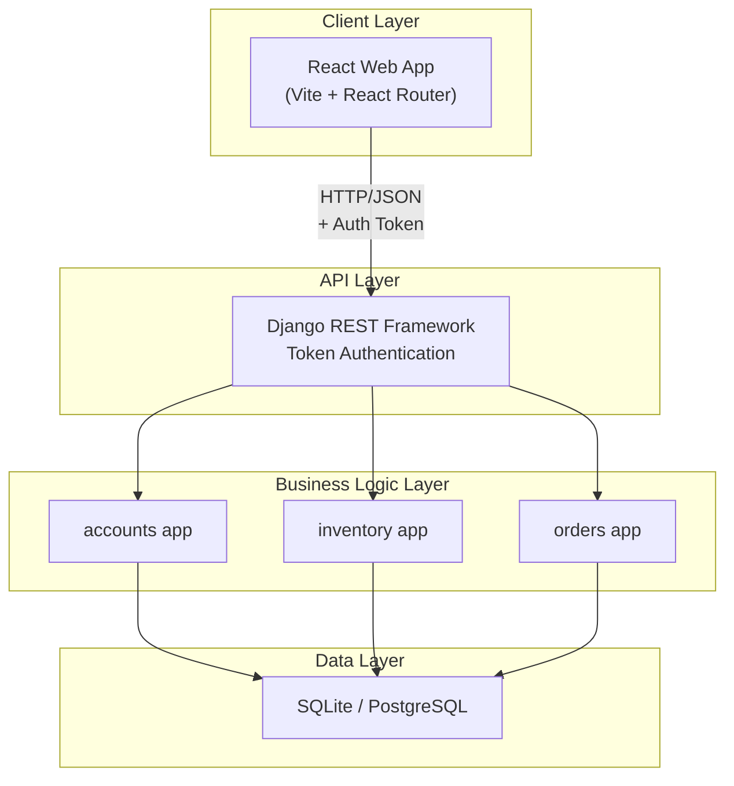
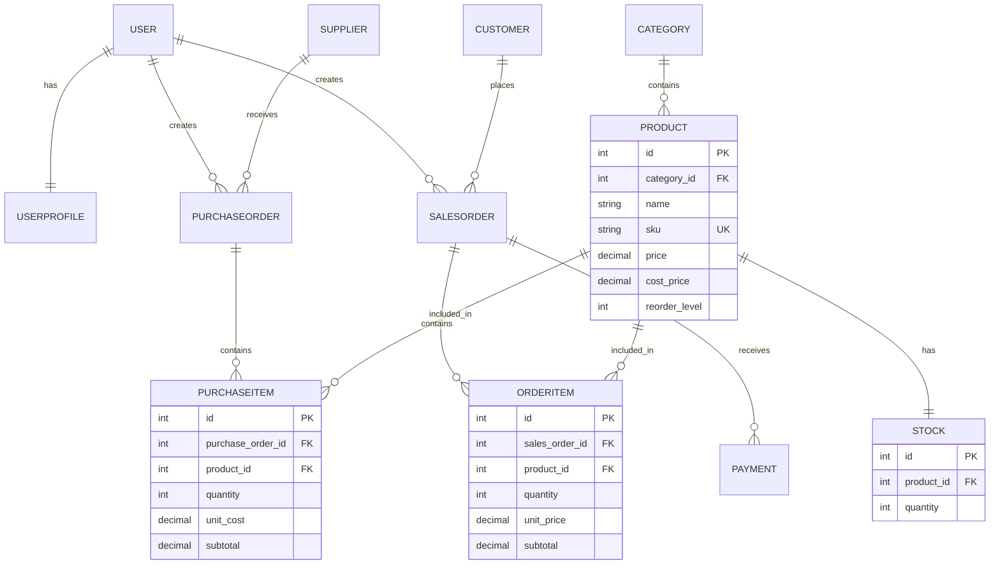
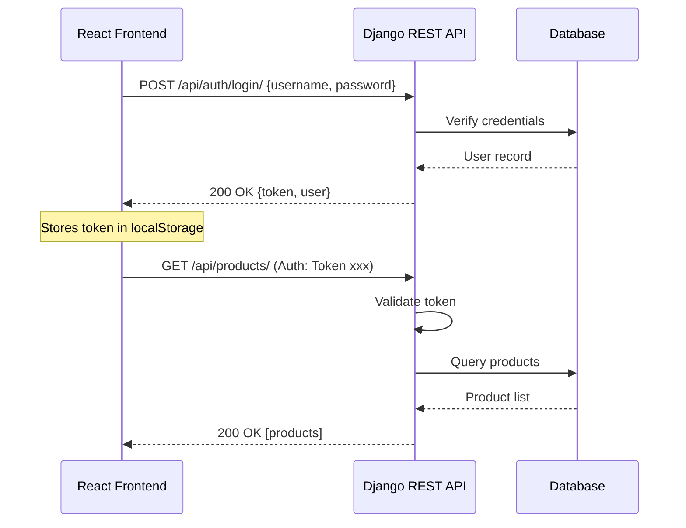

# OpsFlow — Research & Development Proposal

## Digital Operations Management System for Small and Medium-Sized Businesses

---

**Prepared by:** Zainab Khan  
**Date:** September 2026  
**GitHub Repository:** https://github.com/zkestroyer/casestudy  

---

## Overall R&D Process Flow
**Problem → Research → Existing Solutions → Gap → Requirements → Proposed Solution → Design → Prototype → Testing → Evaluation → Improvement**

---

## 1. Problem Statement

Small and medium-sized businesses (SMEs) manage purchasing, inventory, sales, and payment records through a fragmented collection of tools: spreadsheets, paper records, messaging applications, or disconnected software systems. This fragmented approach creates a cascade of operational problems:
- **Stock discrepancies** between recorded and physical inventory
- **Duplicate data entry** across multiple systems
- **Fulfilment delays** from poor visibility into available stock
- **Lack of operational visibility** for management decision-making
- **Stockouts** from failure to reorder in time
- **Overstocking** from poor demand visibility
- **Difficulty tracking transactions** and reconciling payments

## 2. Background & Motivation

The global inventory management software market for SMEs is projected to reach **$5.41 billion by 2032**, growing at a CAGR of **10.18%**. Cloud adoption among SMEs is accelerating, yet **64% of SMEs** still rely on spreadsheets for core operations. 

The motivation for developing OpsFlow arises from the convergence of a clearly defined market gap between expensive enterprise ERP solutions and rudimentary spreadsheet-based tracking, proven technical feasibility via modern web frameworks, and the opportunity to deliver an affordable platform that addresses these documented pain points.

## 3. Target Users

**Primary Target Customer Segment:** Small and Medium-Sized Retailers, Wholesalers, and Distributors (5–50 employees, $500,000–$10M annual revenue).

| Persona | Role | Primary Needs |
|---------|------|---------------|
| **Operations Manager** | Decision-maker | Real-time inventory visibility, PO management, reporting |
| **Warehouse Staff** | End user | Stock receiving, cycle counting via web/tablet |
| **Sales Staff** | End user | Stock availability checks, sales order creation |
| **Business Owner** | Buyer | Operational visibility, profitability insights |
| **Finance/Accounting** | End user | Payment reconciliation, transaction history |

## 4. Existing Solutions

SMEs currently manage operations through a combination of:
- **Spreadsheets (Excel/Google Sheets):** Used for stock tracking. No real-time updates, error-prone.
- **Paper Records:** Used for purchase orders. High loss risk, duplication required.
- **Messaging Apps:** Used for supplier communication. No integration with operational data.
- **Accounting Software (QuickBooks):** Used for payments. Limited inventory functionality.
- **Manual Stock Counts:** Used for reconciliation. Time-consuming, inaccurate.

## 5. Competitor/Market Analysis

| Competitor | Target Customer | Key Features | Pricing | Limitations |
|------------|----------------|--------------|---------|-------------|
| **Zoho Inventory** | E-commerce SMBs | Multi-channel, shipping integrations | Free–$249/mo | Limited reporting, UI not optimised for high volume |
| **Odoo** | SMEs needing ERP | Warehouse management, manufacturing | $31.10/user/mo | Complex setup, high cost with multiple apps |
| **Square** | Retail/restaurants | POS integration, real-time stock | Free–$149/loc | Limited purchasing functionality |
| **inFlow** | B2B / wholesale | B2B portal, manufacturing | $89–$1,055/mo | Expensive for small teams |
| **Cin7** | Multi-location | End-to-end inventory, EDI | From $295/mo | Expensive, overkill for small SMEs |

## 6. Research Gap

1. **The "Spreadsheet to Software" Bridge:** 64% of SMEs on spreadsheets, but existing solutions are either too basic (basic POS) or too complex/expensive (Odoo, Cin7).
2. **Integrated Operations:** Most competitors focus purely on inventory. SMEs need an integrated flow: purchasing → receiving → inventory → sales → payment.
3. **Affordable Entry Point:** Solutions like Cin7 ($295+/month) are out of reach for SMEs with 5 employees. A $39/month entry point is absent.
4. **Practical Automation:** Configurable automation (low-stock alerts, payment tracking) without enterprise complexity is underserved.

## 7. Objectives

1. Design a robust and scalable relational database schema following normalisation principles.
2. Implement a cloud-native backend using Django and Django REST Framework.
3. Build secure RESTful APIs with token-based authentication.
4. Develop a responsive UI using React and Vite.
5. Implement transactional stock management with atomic database operations to prevent race conditions.
6. Provide an operational dashboard with real-time analytics.

## 8. Proposed Digital Solution

**OpsFlow** is a unified, web-based digital operations management platform that solves the fragmented management problem by centralising operations.

- **Automated Stock Management:** Stock atomically increases on Purchase Order confirmation and decreases on Sales Order confirmation.
- **Unified Operations:** Centralised management of Suppliers, Customers, Products, POs, SOs, and Payments.
- **Dashboard Intelligence:** Real-time KPIs, revenue charts, order status breakdowns, and low-stock alerts.

## 9. Functional Requirements

1. Secure login with Token-based authentication.
2. Full CRUD operations for Products, Categories, Suppliers, Customers.
3. Create Purchase Orders with nested line items and confirm to atomically increase stock.
4. Create Sales Orders with nested line items and confirm to validate and atomically deduct stock.
5. Record Payments against Sales Orders with method tracking.
6. Dashboard with KPIs (revenue, total orders, customers, low stock count).
7. Real-time stock level viewing with reorder level comparison.
8. Auto-create Stock record on Product creation via Django signals.

## 10. Non-Functional Requirements

1. **Performance:** API responses under 500ms for typical operations.
2. **Security:** Token authentication, CORS configuration, HTTPS-ready.
3. **Data Integrity:** `transaction.atomic()` blocks for all stock mutation operations.
4. **Responsiveness:** UI adapts to desktop (1024px+), tablet (768px), and mobile (480px).
5. **Maintainability:** Modular Django apps (`accounts`, `inventory`, `orders`).

## 11. System Architecture

## 12. Database & Normalisation

The database schema follows **Third Normal Form (3NF)**:
- **1NF:** All tables have atomic values in each column. No repeating groups.
- **2NF:** All non-key attributes are fully functionally dependent on the entire primary key (single-column auto-increment IDs).
- **3NF:** No transitive dependencies. Category information is stored in a separate `Category` table; Stock quantity is isolated in a separate `Stock` table to eliminate update anomalies and prevent locking the main Product record. `PurchaseItem.subtotal` is derived but stored for historical accuracy (preserving the price at the time of the transaction).

## 13. ERD

## 14. API Architecture

## 15. Django Backend Architecture

The backend follows a domain-driven structure divided into modular Django apps:
- **`config`**: Core settings, routing, and CORS/Authentication setup.
- **`accounts`**: User models, profiles, and authentication logic. Utilises Django signals to auto-generate UserProfiles.
- **`inventory`**: Catalog management (Products, Categories, Stock, Suppliers, Customers). 
- **`orders`**: Procurement and Sales workflows. Employs a nested serializer create pattern to save an order and its items in a single HTTP request, utilising `transaction.atomic()` for safety.

## 16. React Frontend Architecture

- **React 18 & Vite**: Component-based UI with fast HMR.
- **Routing**: React Router DOM for SPA navigation.
- **State Management**: Context API for global authentication state; local state for forms.
- **API Communication**: Axios interceptors automatically attach the authentication Token to every outbound request.
- **Visualisations**: Recharts for interactive Revenue Line Charts and Order Status Pie Charts.
- **Styling**: Custom CSS design system using the Inter font and Lucide React icons.

## 17. Android/API integration where applicable

The current architecture is a decoupled, headless REST API. This makes it inherently **mobile-ready**. 
An Android application (written in Kotlin or Flutter) can consume the exact same `/api/` endpoints that the React web application uses. Token authentication works identically across platforms. Future integration would only require building the mobile UI layers; zero backend modification is necessary.

## 18. Development Methodology

The project adheres to an **Agile (Scrum-Inspired) Methodology**:
- **Iterative development**: Built in vertical slices (backend models + API + frontend view per feature).
- **Continuous integration**: GitHub repository for version control and rollback capability.
- **Prototyping**: Fast PoC development for the API before committing to the UI design system.

## 19. Implementation Plan

| Phase | Timeline | Deliverables | Status |
|-------|----------|-------------|--------|
| **Phase 1: Planning** | Week 1 | Requirements analysis, ERD design, tech selection | ✅ Complete |
| **Phase 2: Database** | Week 1–2 | Django models, migrations, signals | ✅ Complete |
| **Phase 3: Backend API** | Week 2–4 | DRF serializers, ViewSets, atomic transactions | ✅ Complete |
| **Phase 4: Frontend Shell** | Week 3–5 | React setup, routing, layout, design system | ✅ Complete |
| **Phase 5: Feature Pages** | Week 4–6 | All CRUD pages, order creation, stock management | ✅ Complete |
| **Phase 6: Dashboard** | Week 6–7 | KPI cards, Recharts visualisations | ✅ Complete |
| **Phase 7: Handover** | Week 8 | Technical documentation, final repository push | ✅ Complete |

## 20. Testing & Evaluation

| Test Case | Feature | Expected Result | Status |
|-----------|---------|-----------------|--------|
| TC01 | Login | Returns 200 & Token | ✅ Pass |
| TC02 | Create Product | 201 Created & Stock auto-created | ✅ Pass |
| TC03 | Confirm Sales Order | Stock deducted atomically, status updated | ✅ Pass |
| TC04 | Confirm Sales Order (Insufficient Stock) | 400 Bad Request with error message | ✅ Pass |
| TC05 | Confirm Purchase Order | Stock incremented atomically | ✅ Pass |
| TC06 | Responsive UI | Adapts to 480px, 768px, 1024px | ✅ Pass |

## 21. Expected Results

1. **Elimination of manual stock tracking** — real-time inventory with automatic updates.
2. **Unified operations** — purchasing, sales, inventory, and payments in one platform.
3. **Actionable dashboard** — KPI cards, revenue trends, order breakdowns.
4. **Data integrity** — atomic transactions prevent stock discrepancies.
5. **Scalable architecture** — decoupled frontend/backend ready for mobile integration.

## 22. Limitations and Risks

| Limitation | Impact | Mitigation / Future Fix |
|------------|--------|-------------------------|
| SQLite in development | Not suitable for concurrent production | Migrate to PostgreSQL |
| No real-time push updates | Dashboard requires manual refresh | WebSocket integration |
| Single user role | No Admin vs. Staff UI distinction | Role-based UI rendering |
| No barcode scanning | Manual product lookup required | Webcam/scanner integration |

## 23. Future Improvements

1. **Automated Reorder Alerts:** Email/SMS notifications via Celery and SendGrid.
2. **Multi-Warehouse Support:** Track stock across physical locations with transfers.
3. **PDF Invoicing:** Generate downloadable receipts via ReportLab.
4. **E-Commerce Integration:** Sync with Shopify/WooCommerce APIs.
5. **Native Mobile App:** Build Android app consuming the existing REST API.

## 24. Market and Financial Feasibility

| Metric | Value |
|--------|-------|
| **TAM** (Global SME Inventory Software) | $2.74 billion (2025) → $5.41 billion (2032) |
| **SAM** (English-speaking markets) | $1.15 billion |
| **SOM** (Target segment) | $138 million |
| **Proposed Plan Pricing** | Starter: $39/mo, Pro: $79/mo, Biz: $129/mo |
| **Break-even timeline** | Month 1 (requires only 7 active subscribers) |
| **Year 3 Projected ARR** | $1,638,000 (at 3,500 subscribers) |

**Conclusion:** The project is technically feasible, commercially viable, and addresses a genuine market need. The combination of a large and growing market ($2.74B), validated customer pain (64% on spreadsheets), proven technology (Django/React prototype), competitive pricing ($39/month entry), and sustainable unit economics makes this a compelling business opportunity.

---
*End of Document*
